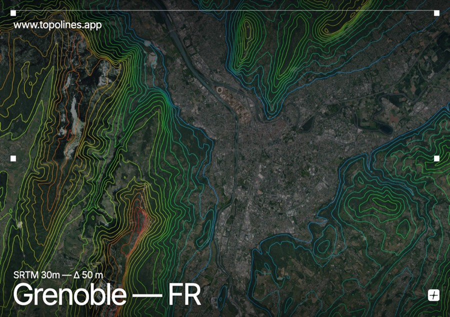
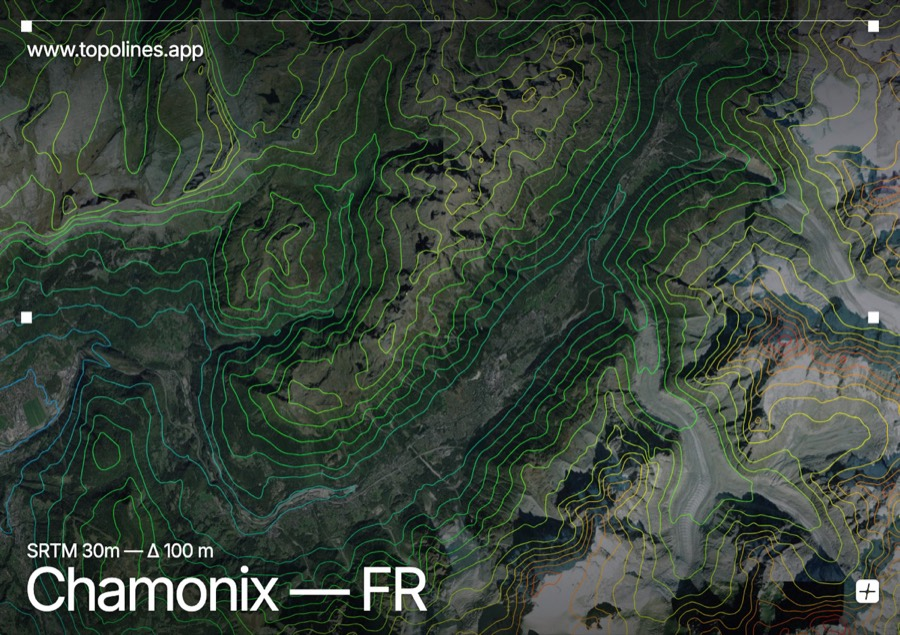
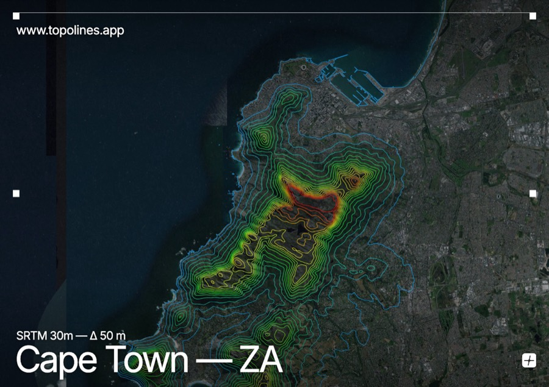
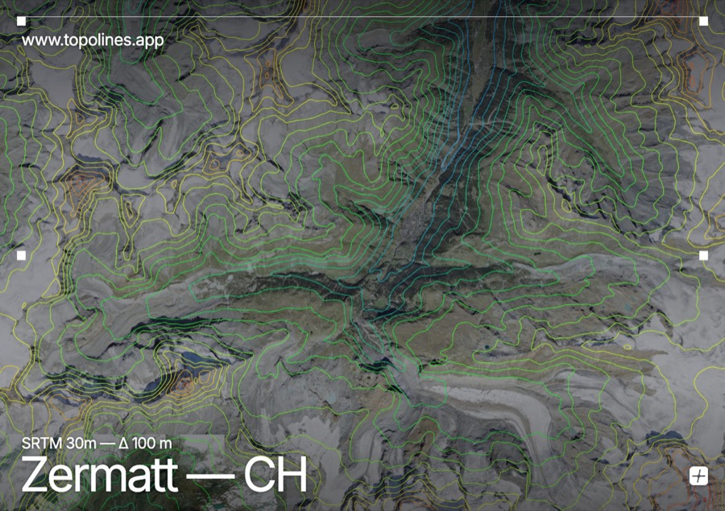
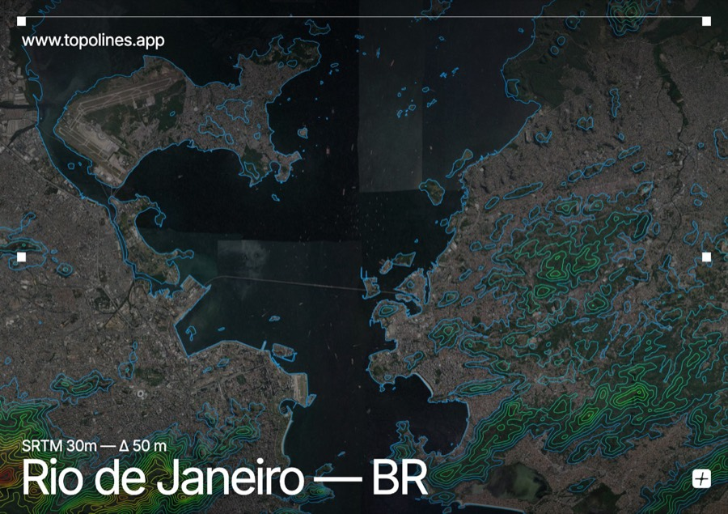
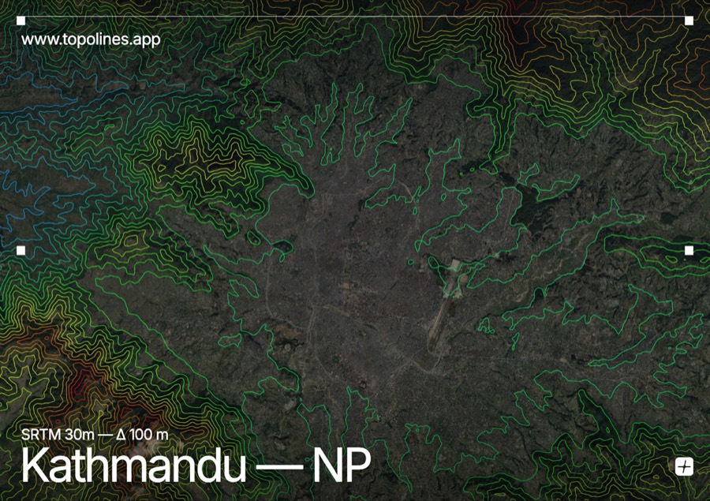
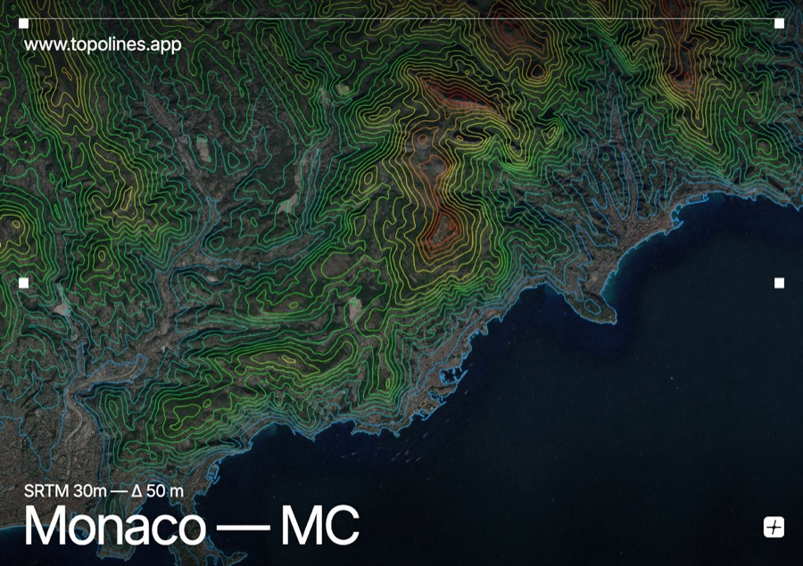

# TopoLines

**Contour lines from sourced elevation data, anywhere on Earth.**

Draw a zone, and TopoLines traces its contours from a named, citable elevation model — GEDTM30 30 m bare-earth worldwide, national lidar terrain models down to 1 m (0.5 m in Switzerland) picked by zone size, or your own GeoTIFF — then exports them as GeoJSON or DXF in your CRS, or as SVG and PNG.

[**Open the app →**](https://www.topolines.app/app) · [Website](https://www.topolines.app) · [Browse maps](https://www.topolines.app/topographic-map) · [Blog](https://www.topolines.app/blog)

---

## What it is

TopoLines covers the contour step of a QGIS / GDAL workflow — finding the right DEM, clipping it, tracing at your interval, cleaning DEM noise, reprojecting — without installing or configuring a GIS. Search a place, drag a box over it, and get its **real topography** as vector contours.

**Every line is a real elevation on a real place.** The dataset that served your zone is shown in the editor and written, with its licence credit, into the metadata of every export.

## Elevation data

| Dataset | Publisher | Resolution | Coverage | Licence |
|---|---|---|---|---|
| GEDTM30 v1.2 (bare-earth DTM) | OpenGeoHub, via OpenTopography | 30 m | Worldwide | CC BY 4.0 |
| Terrain Tiles (GeoTIFF) | Mapzen / Nextzen, AWS Open Data | ~10 m | Worldwide | Open data |
| RGE ALTI® | IGN | 1–5 m | Metropolitan France | Etalab 2.0 |
| 3DEP | U.S. Geological Survey | Up to 1 m (lidar where flown, ~10 m elsewhere) | United States | Public domain |
| swissALTI3D | swisstopo | 0.5–10 m | Switzerland | Open data (attribution) |
| LIDAR Composite DTM | Environment Agency | 1–20 m | England | OGL v3.0 |
| MDT | Instituto Geográfico Nacional | 5 m | Spain | CC BY 4.0 |
| ALS DTM Österreich | BEV | 1–20 m | Austria | CC BY 4.0 |
| TINITALY/1.1 | INGV | 10–30 m | Italy | CC BY 4.0 |
| DGM1 | Bavaria, North Rhine-Westphalia surveying agencies | 1–20 m | Bavaria, NRW | CC BY 4.0 / dl-de/zero-2.0 |
| Your own GeoTIFF | You | Your file's | Your file | Yours |

A national model is used only when the zone lies entirely inside its coverage — a map is never stitched from two datasets. Details and per-country limits: [Data sources](docs/data-sources.md). Endpoints, native resolutions and access notes for each model: [Open national elevation models](docs/national-elevation-models.md).

## Features

- 📐 **GIS & CAD exports** — **GeoJSON** (each feature carries its elevation and contour type) and **DXF** (one layer per contour type), in WGS 84, automatic UTM, Lambert-93, Web Mercator, British National Grid or ETRS89 UTM 30N / 31N
- 🗺️ **Cartographic conventions** — index contours, auxiliary (half-interval) contours on flat ground, depression contours with inward hachures, contour labels cut into the line, scale bar, north arrow and legend
- 🎚️ **Trace parameters** — contour interval down to 5 m, smoothing / simplification, minimum contour length filter to drop DEM-noise loops
- 🌊 **Real coastlines** — contours clipped against OpenStreetMap shorelines (`natural=coastline`), so lines stop where the land does
- 📤 **Bring your own DEM** — upload a georeferenced GeoTIFF and trace contours on your own raster (Pro)
- ✳️ **Two render modes** — contour **Lines**, or **Points**: the same terrain as a field of dots, squares or crosses sized by height
- 🎨 **Styling** — elevation gradients (including Imhof-style hypsometric presets), stroke taper, flat or transparent background
- 🖊️ **SVG for design tools** — editable paths grouped by elevation, every layer a named group, pastes cleanly into Figma, Illustrator or Inkscape
- 🖼️ **PNG** — 1024, 2048 or 3200 px wide
- 🧩 **Figma plugin** — generate contours without leaving your canvas
- 🆓 **Free tier that actually exports** — sign in with Google or GitHub, GEDTM30 30 m, PNG 1024 px, no payment

## Who uses it

- **GIS and survey users** who need contours for an area quickly, with a named source and CRS
- **Architects, landscape architects and engineers** doing site studies — DXF in a projected CRS, on 1–2 m lidar where available
- **Cartographers and designers** who want editable, correctly sourced vectors
- **Makers** cutting layered terrain models (one DXF/SVG layer per elevation)

## Gallery

Every image below was generated with TopoLines from real elevation data.

| | |
|---|---|
|  **Chamonix** — Mont Blanc massif |  **Cape Town** — Table Mountain |
|  **Zermatt** — Matterhorn |  **Rio de Janeiro** — Tijuca massif |
|  **Kathmandu** — valley rim |  **Monaco** — sea to 1,100 m |

More: [topolines.app/topographic-map](https://www.topolines.app/topographic-map)

## Documentation

| Guide | What's in it |
|---|---|
| [Getting started](docs/getting-started.md) | Your first map in under a minute |
| [Contour settings](docs/contour-settings.md) | Interval, relative mode, simplification, taper, gradient, annotations |
| [Render modes](docs/render-modes.md) | Lines vs Points, and every Points control |
| [Cartographic options](docs/cartographic-options.md) | Auxiliary & depression contours, labels, Imhof presets, scale bar / north arrow / legend |
| [Exports & credits](docs/exports.md) | GeoJSON, DXF, SVG, PNG, output CRS, how credits are calculated |
| [Figma plugin](docs/figma-plugin.md) | Generating contours inside Figma |
| [Data sources](docs/data-sources.md) | Elevation models, licences, source selection, coastlines, CRS |
| [Open national elevation models](docs/national-elevation-models.md) | Every open DTM we use: native resolution, licence, endpoint, access quirks ([CSV](data/national-elevation-models.csv)) |
| [FAQ](docs/faq.md) | Licensing, commercial use, accuracy, limits |

## Feedback & feature requests

This repository is the public home for **documentation, feedback and roadmap**.

- 💡 [Request a feature](../../issues/new?template=feature_request.md)
- 🐛 [Report a bug](../../issues/new?template=bug_report.md)

Feature requests are genuinely read and prioritised — several shipped features started as user suggestions.

## Pricing

Free to try — just sign in with a Google or GitHub account, no payment. Paid features (HD PNG, SVG / DXF / GeoJSON export, national data down to 1 m, DEM upload, larger areas) run on one-off credit packs — **no subscription**, and credits never expire.

See [current pricing](https://www.topolines.app/pricing). Full documentation: [topolines.app/docs](https://www.topolines.app/docs).

---

Built by [Alexis Oulès](https://www.topolines.app) · [topolines.app](https://www.topolines.app)

*This repository contains documentation and media only. TopoLines is a commercial product; its source code is not public.*

